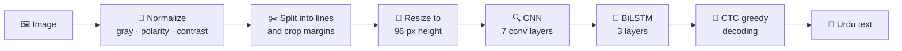

<<<<<<< HEAD
<div align="center">

# 📖 Urdu OCR · CRNN + CTC

### Read **printed Urdu** text from images, built from scratch in PyTorch


**[🚀 Live demo](https://urdu-optical-character-recognition-ocr-deep-learning.streamlit.app/)** · **[📚 Full documentation](docs/DOCUMENTATION.md)** · **[📊 Benchmarks](#-benchmarks)** · **[🙏 Credits](#-data-and-credits)**

*(Replace `#` above with your Streamlit link. Free Streamlit apps sleep after a period of inactivity, so if you see a wake-up button, click it and wait about a minute.)*

</div>

---

> [!IMPORTANT]
> ✍️ **This model is NOT trained on handwritten text.** All training data is printed Urdu. It will not read handwriting, and it is also weak on calligraphy and decorative fonts.

## 🔤 What is OCR?

**OCR** stands for **Optical Character Recognition**: software that reads the text inside an image (a scan, a photo or a screenshot) and turns it into real, editable text.

This project is an OCR system for Urdu. You give it an image of printed Urdu, and it returns the text.

## ✨ Highlights

| | |
|---|---|
| 🧠 **Model** | CNN (7 conv layers) + 3-layer BiLSTM + CTC loss, 12.5 M parameters |
| 🎯 **Accuracy** | **7.19% character error rate** on 1,602 held-out lines |
| 🖼️ **Flexible input** | Single lines, loosely cropped lines, or a few stacked lines (automatic line splitting) |
| 🌗 **Robust to scans** | Handles light-on-dark text, tinted paper, blur, noise and low resolution |
| 🏋️ **Training** | 55 epochs in 8.07 hours on one Kaggle T4 GPU |
| 🛠️ **Built from scratch** | Own data pipeline, model, CTC training loop, decoder, metrics and demo app |

## 📊 Benchmarks

### 🏆 Final model (v2): test results

Evaluated on **1,602 lines that were never used for training or for choosing the model**.

| Dataset | Lines | CER ⬇️ | Exact-match lines ⬆️ |
|---|---:|---:|---:|
| **🌍 Overall** | **1,602** | **0.0719** | **37.1%** |
| 🤖 UTRSet-Synth (synthetic) | 1,000 | 0.0760 | 45.5% |
| 📜 UTRSet-Real (part 1) | 429 | 0.0793 | 16.8% |
| 📜 UTRSet-Real (part 2) | 73 | 0.0663 | 12.3% |
| 📰 UPTI (newspaper-style) | 100 | 0.0128 | 58.0% |

> **CER** (character error rate) = character edits needed to fix a prediction ÷ true text length. Lower is better. A CER of 0.0719 means about **7 wrong characters per 100**, or roughly **92.8% of characters correct**.

### 📈 Progress from the first model to the final one

| | v1 baseline | **v2 (final)** |
|---|---|---|
| Training data | 20,000 synthetic lines | **33,171 lines, 3 datasets** |
| Input height | 64 px, fixed 1024 px canvas | **96 px, variable width** |
| Model | 5 conv blocks, 2-layer BiLSTM, about 4.2 M params | **7 conv layers, 3-layer BiLSTM, 12.5 M params** |
| Synthetic test CER | 0.1983 | 0.0760 |
| Real-scan CER | 0.2979 (0.2842 after fine-tuning) | 0.0793 / 0.0663 |
| Training time | about 1.6 h | 8.07 h |

### 🧾 Model card

| | |
|---|---|
| Parameters | 12.5 M |
| Weights file | about 50 MB |
| Input | grayscale line image, 96 px high, up to 4096 px wide at inference |
| Output classes | 164 (163 characters + CTC blank) |
| Hardware used | 1x NVIDIA Tesla T4 (Kaggle) |
| Training time | 8.07 h, 55 epochs, about 8.8 min per epoch |
| Best validation CER | 0.0700 |
| Inference speed | not measured yet |

> [!WARNING]
> **Read the numbers carefully.**
> - The test lines come from the **same books and sources as the training lines**, just from different pages. On a completely new document, expect a higher error rate.
> - The two UTRSet-Real test parts and the UPTI part are small (429, 73 and 100 lines), so their individual figures are rough.
> - v1 was tested on a different set, so v1 and v2 numbers are **not directly comparable**. The improvement is real, but 0.07 overstates the accuracy on unseen documents.

## 🧠 How it works



- 🔍 **CNN:** turns the image into a sequence of "slices", one per 4 pixels of width.
- 🔁 **BiLSTM:** reads the slices in both directions, so each slice knows its neighbours.
- 🎯 **CTC loss:** lets the model learn from the text alone, without knowing where each letter sits in the image.
- ↔️ The image is flipped horizontally first, so Urdu (right to left) is read in the right order.

## 🚀 Quick start

```bash
git clone https://github.com/saadnaeem463/Urdu-Optical-Character-Recognition-OCR-Deep-Learning.git
cd Urdu-Optical-Character-Recognition-OCR-Deep-Learning
python -m venv venv
venv\Scripts\activate            # Windows. On macOS/Linux: source venv/bin/activate
pip install -r requirements.txt
streamlit run app.py
```

Open `http://localhost:8501` and upload an image of printed Urdu.

### 🐍 Use it from Python

```python
import json, torch
from PIL import Image
from ocr_lib import CRNN, read_image

chars = json.load(open("chars.json", encoding="utf-8"))
idx2char = {i + 1: c for i, c in enumerate(chars)}        # 0 is the CTC blank
model = CRNN(len(chars) + 1)
model.load_state_dict(torch.load("crnn_best.pt", map_location="cpu"))
model.eval()

lines = read_image(Image.open("page.png"), model, idx2char, "cpu")
print("\n".join(lines))
```

## ✅ What it can and cannot do

| ✅ Works | ❌ Does not work |
|---|---|
| Printed Urdu text, one line | ✍️ **Handwriting** (no handwritten training data) |
| Loosely cropped lines with margins | 🎨 Calligraphy and decorative fonts |
| Light-on-dark text, tinted paper | 📑 Multi-column pages |
| A few stacked lines (auto line splitting) | 📐 Strongly skewed or rotated photos |

## 📁 Repository structure

```
Urdu-Optical-Character-Recognition-OCR-Deep-Learning/
├── app.py                         Streamlit demo
├── ocr_lib.py                     preprocessing, line splitting, model, decoding
├── crnn_best.pt                   trained weights (about 50 MB)
├── chars.json                     character vocabulary (the order matters)
├── config.json                    model settings used in training
├── requirements.txt
├── urdu_ocr_v2_training.ipynb     final training notebook (v2, Kaggle)
├── notebooks/
│   └── v1_baseline.ipynb          first baseline model (UTRSet-Synth only)
├── curves.png                     training loss and validation CER
├── results.json                   per-epoch history and final test results
├── aug_samples.png                examples of the training augmentation
├── README.md
└── docs/
    └── DOCUMENTATION.md           full technical documentation
```

## 🏋️ Training summary

| | |
|---|---|
| Framework | PyTorch, mixed precision |
| Optimizer | AdamW, peak learning rate 8e-4, cosine decay |
| Data | 33,171 lines: train 29,913 · val 1,656 · test 1,602 |
| Augmentation | rotation, shear, wavy baseline, stroke thickness, blur, low resolution, JPEG artifacts, lighting, noise, margins |
| Run | Kaggle "Save & Run All" (keeps running with the browser closed) |

## 📚 Data and credits

All training data comes from the **UTRNet** project:

| Dataset | Used as | What it is |
|---|---|---|
| **UTRSet-Synth** | 20,000 lines | Computer-generated printed Urdu lines, 130+ fonts |
| **UTRSet-Real** | 11,161 lines (two parts) | Real printed-document line images |
| **UPTI** | 2,010 lines | Urdu printed text images (newspaper-style lines) |

- 📦 Datasets and original repository: <https://github.com/abdur75648/UTRNet-High-Resolution-Urdu-Text-Recognition>
- 📄 Paper: *UTRNet: High-Resolution Urdu Text Recognition in Printed Documents*, ICDAR 2023 · [arXiv](https://arxiv.org/abs/2306.15782)
- 🗞️ UPTI source (as given in the UTRNet repository): <https://ui.adsabs.harvard.edu/abs/2013SPIE.8658E..0NS/abstract>

If you use this work, please also cite the UTRNet paper:

```bibtex
@InProceedings{10.1007/978-3-031-41734-4_19,
  author    = {Rahman, Abdur and Ghosh, Arjun and Arora, Chetan},
  title     = {UTRNet: High-Resolution Urdu Text Recognition in Printed Documents},
  booktitle = {Document Analysis and Recognition - ICDAR 2023},
  year      = {2023},
  publisher = {Springer Nature Switzerland},
  pages     = {305--324},
  doi       = {10.1007/978-3-031-41734-4_19}
}
```

## 📜 License

| Part | License |
|---|---|
| 💻 Code (`app.py`, `ocr_lib.py`, notebook) | MIT (add a `LICENSE` file) |
| 🧠 Trained weights and anything derived from the datasets | **CC BY-NC-SA 4.0**: non-commercial (academic and research) use only, with attribution and share-alike |

> [!NOTE]
> The UTRNet authors license their datasets under **CC BY-NC-SA 4.0 for non-commercial academic and research use only**, and state that they must not be used for any other purpose without the authors' explicit permission. Because the weights were trained on that data, **do not use them commercially**. This is not legal advice.

## 👤 Author

**Saad Naeem** · [GitHub](https://github.com/saadnaeem463) · [LinkedIn](https://www.linkedin.com/in/saad-naeem-5138a3409)

<div align="center">

⭐ If this project helped you, consider starring the repo.

</div>
=======
# Urdu-Optical-Character-Recognition-OCR-Deep-Learning
>>>>>>> origin/main
