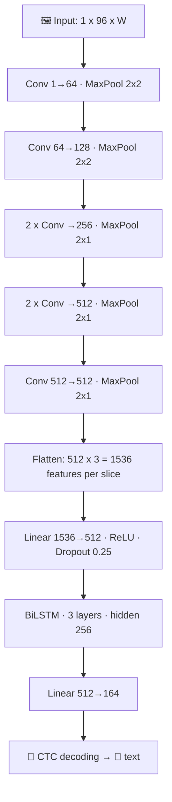

<div align="center">

# 📚 Urdu OCR (CRNN + CTC): Technical Documentation


[⬅️ Back to README](../README.md)

</div>

---

## 📑 Contents

1. [🎯 Goal](#-1-goal)
2. [🔤 Glossary](#-2-glossary)
3. [🕰️ Project history](#️-3-project-history-two-versions)
4. [🗂️ Data](#️-4-data)
5. [🧹 Preprocessing](#-5-preprocessing)
6. [🧠 Model](#-6-model)
7. [🏋️ Training](#️-7-training)
8. [📊 Benchmarks and results](#-8-benchmarks-and-results)
9. [🔬 Error analysis](#-9-error-analysis)
10. [🖥️ Inference and demo](#️-10-inference-pipeline-and-demo)
11. [🔁 Reproduce](#-11-how-to-reproduce)
12. [⚠️ Limitations](#️-12-limitations)
13. [🔭 Next steps](#-13-possible-next-steps)
14. [🙏 Credits and license](#-14-credits-and-license)

---

## 🎯 1. Goal

Build an image-to-text model for **printed Urdu** from scratch, as a deep learning project that combines a **CNN** (reads the image) and an **RNN** (reads the result as a sequence). The aim was a model that reads a text line and, with a small preprocessing step, also handles loosely cropped lines and a few stacked lines.

> [!IMPORTANT]
> ✍️ **Out of scope: handwriting.** The model is **not trained on handwritten text**. Every training image is printed Urdu. It will not read handwriting and is also weak on calligraphy. Other things out of scope: multi-column pages and strongly skewed photos.

## 🔤 2. Glossary

| Term | Meaning |
|---|---|
| **OCR** | **Optical Character Recognition**: turning the text in an image into real text |
| **CNN** | Convolutional Neural Network: finds visual patterns (strokes, curves, dots) in the image |
| **RNN / LSTM** | Recurrent network / Long Short-Term Memory: reads a sequence while remembering context |
| **BiLSTM** | An LSTM that reads the sequence in both directions |
| **CRNN** | CNN + RNN joined into one model |
| **CTC** | Connectionist Temporal Classification: a loss that trains without knowing where each letter sits |
| **CER** | Character Error Rate: edits needed to fix a prediction ÷ true text length (lower is better) |
| **Exact match** | Share of lines predicted with zero mistakes |
| **Slice / time step** | One vertical strip of the image, as seen by the model (one per 4 pixels of width) |

## 🕰️ 3. Project history (two versions)

| | v1 (baseline) | **v2 (final, shipped)** |
|---|---|---|
| Purpose | Learn CRNN + CTC end to end | Better accuracy and real-world robustness |
| Data | UTRSet-Synth only (20,000 lines) | 33,171 lines from 3 datasets |
| Input | 64 px tall, fixed 1024 px wide canvas | 96 px tall, variable width |
| Model | 5 conv blocks, 2-layer BiLSTM, about 4.2 M parameters | 7 conv layers, 3-layer BiLSTM, 12.5 M parameters |
| Training | 60 epochs, about 99 s per epoch | 55 epochs, about 8.8 min per epoch (8.07 h) |
| Result | Synthetic test CER 0.1983; UTRSet-Real CER 0.2979 (0.2842 after fine-tuning) | Overall test CER 0.0719 |

> [!NOTE]
> **🐛 A bug that taught something.** The first v1 training run reached only CER 0.79 on the test set. The cause was one line in the Dataset class: the width cap used the image *height* (`min(IMG_H, ...)`) instead of the canvas *width*, so every text line was squeezed into a 64 px wide strip. After fixing it and widening the canvas to 1024 px, validation CER fell from about 0.8 to 0.19. **Lesson: look at what the model actually receives before blaming the model.**

📓 **Notebooks:** the v1 baseline is `notebooks/v1_baseline.ipynb` and the final v2 training notebook is `urdu_ocr_v2_training.ipynb` in the repository root. `aug_samples.png` shows examples of the v2 augmentation.

**Why v2.** v1's error analysis pointed at three things: dot-variant letters were confused (small input height), long lines were weakest (squashing), and the model failed on real scans (domain gap). v2 answers these with a taller input, no fixed-width squashing, real scans in training, and strong augmentation.

## 🗂️ 4. Data

### 4.1 Sources

All data comes from the **UTRNet** project ([repository](https://github.com/abdur75648/UTRNet-High-Resolution-Urdu-Text-Recognition)). After merging and cleaning, there are **33,171 labelled text lines**:

| Dataset | Name in the code | Lines | Description |
|---|---|---:|---|
| **UTRSet-Synth** | `synth` | 20,000 | Computer-generated printed lines, 130+ fonts |
| **UTRSet-Real** | `real_train1` | 9,065 | Real printed-document line images |
| **UTRSet-Real** | `real_train2` | 2,096 | Real printed-document line images |
| **UPTI** | `set3` | 2,010 | Urdu printed text images, newspaper-style lines |

- UPTI's original source, as given in the UTRNet repository: <https://ui.adsabs.harvard.edu/abs/2013SPIE.8658E..0NS/abstract>
- All 33,171 images were readable; none were dropped as tiny or corrupt.
- Files were merged into one folder with a single `labels.txt` (format: `image_name text`) and a `mapping.csv` recording each image's source and original file name.

### 4.2 Vocabulary

**163 unique characters** from all labels, plus the CTC blank = **164 classes**. The list is saved as `chars.json`. Its order defines the class numbers (blank = 0, characters = 1 to 163), so it must always be used together with the weights. Rare characters (fewer than 5 uses) are mostly Latin letters and some Arabic marks, and the model will not learn those well.

### 4.3 Train / validation / test split

The split is done **per source**, and lines from the same page stay on the same side:
- UTRSet-Real style names (`doc_page_line.jpg`) are grouped by document and page.
- Plain numbered files are grouped in blocks of 50 consecutive lines.
- 5% of the groups go to validation, 5% to test, the rest to training. Seed 42.

| Dataset | Train | Val | Test |
|---|---:|---:|---:|
| UTRSet-Synth | 18,000 | 1,000 | 1,000 |
| UTRSet-Real (part 1) | 8,129 | 507 | 429 |
| UTRSet-Real (part 2) | 1,974 | 49 | 73 |
| UPTI | 1,810 | 100 | 100 |
| **Total** | **29,913** | **1,656** | **1,602** |

Extra filtering of the training set: **114 lines dropped** because the label had more characters than the image had time steps (CTC cannot fit them), and **2,153 very wide lines squashed** by the width cap (2048 px). Real scans are shown **twice per epoch**, giving 39,899 training samples and 960 batches per epoch.

> [!WARNING]
> Pages are separated, but **books are not**. Test lines come from the same books and styles as training lines, so the scores are optimistic for unseen documents.

## 🧹 5. Preprocessing

1. 🌫️ **Grayscale.**
2. 🌗 **Polarity fix:** light text on a dark background is inverted (mean brightness under 110).
3. 🎚️ **Contrast stretch:** fixes yellowed paper and faded scans.
4. ✂️ **Auto-crop** of empty margins.
5. 📐 **Resize** to a height of **96 px**, keeping the aspect ratio (width cap 2048 px for training, 4096 px for inference).
6. ↔️ **Horizontal flip**, so Urdu (right to left) is read first-letter-first.
7. 📦 **Batching by width:** lines of similar width share a batch (less padding, faster training). Each batch is padded only to its widest line, and CTC gets the true number of time steps for each line, so padding never counts as text.

### 🎲 Augmentation (training only)

Small rotation and shear, wavy baseline, thicker or thinner strokes, Gaussian and motion blur, low resolution, JPEG artifacts, lighting changes, noise and extra margins. The goal is to make clean synthetic lines look like bad scans and photos.

## 🧠 6. Model

### 6.1 Architecture (v2)



| Stage | Layers | Output (height x width) |
|---|---|---|
| CNN block 1 | Conv(1→64) + BN + ReLU, MaxPool(2,2) | 48 x W/2 |
| CNN block 2 | Conv(64→128) + BN + ReLU, MaxPool(2,2) | 24 x W/4 |
| CNN block 3 | 2 x Conv(→256) + BN + ReLU, MaxPool(2,1) | 12 x W/4 |
| CNN block 4 | 2 x Conv(→512) + BN + ReLU, MaxPool(2,1) | 6 x W/4 |
| CNN block 5 | Conv(512→512) + BN + ReLU, MaxPool(2,1) | 3 x W/4 |
| Flatten | 512 channels x 3 rows = 1536 numbers per slice | W/4 slices |
| Projection | Linear(1536→512) + ReLU + Dropout(0.25) | W/4 x 512 |
| BiLSTM | 3 layers, hidden size 256 per direction, dropout 0.25 | W/4 x 512 |
| Output | Linear(512→164) | W/4 x 164 |

- **7 convolution layers**, 3x3 kernels, padding 1. (The notebook's intro text says 8, but the code builds 7.)
- The CNN shrinks the height by 32 and the width by only 4, so there is **one time step per 4 pixels of width**.
- **12.5 million parameters**; the weights file is about 50 MB.

### 6.2 CTC loss

The labels contain only the text, not where each letter sits. CTC lets the model output one prediction per slice (a character or the special **blank**), then adds up the probability of every output sequence that collapses to the correct text (merge repeats, drop blanks). Training lowers `-log(that probability)`. `nn.CTCLoss(blank=0, zero_infinity=True)` is used, and the loss is computed in float32 even when the model runs in mixed precision.

### 6.3 Decoding

Greedy decoding: take the best class per slice, merge repeats, drop blanks, map numbers to characters. There is no beam search and no language model.

## 🏋️ 7. Training

| Setting | Value |
|---|---|
| Framework | PyTorch, mixed precision (AMP) |
| Hardware | Kaggle notebook, one NVIDIA Tesla T4 |
| Optimizer | AdamW, weight decay 0.01 |
| Learning rate | Peak 8e-4; warm-up in the first epoch, then cosine decay to 2% of the peak |
| Gradient clipping | 5.0 |
| Batch | Up to 64 lines and at most 40 x 1024 pixels of width (bucketed by width) |
| Time budget | 8.5 hours; the first epoch measured the speed and planned the number of epochs |
| Epochs | **55** (8.6 min for epoch 1, then about 8.8 min each) |
| **Total time** | **8.07 hours** |
| Checkpoint | Best validation CER, saved after each epoch |
| Seed | 42 |

**Curve summary** (see `curves.png` and `results.json`): validation CER was 1.00 after epoch 1 (the model first predicts only blanks, the usual CTC plateau), 0.41 after epoch 2, 0.18 after epoch 5, and flattened around 0.070 from about epoch 30. Training loss ended at about 0.165. **Best validation CER: 0.0700.**

**How it was launched:** Kaggle "Save & Run All (Commit)", so training kept running with the browser closed. A draft (interactive) session stops when the tab closes.

## 📊 8. Benchmarks and results

### 8.1 🏆 v2 final test (1,602 held-out lines)

| Dataset | Lines | CER ⬇️ | Exact match ⬆️ |
|---|---:|---:|---:|
| **🌍 Overall** | 1,602 | **0.0719** | **37.1%** |
| 🤖 UTRSet-Synth | 1,000 | 0.0760 | 45.5% |
| 📜 UTRSet-Real (part 1) | 429 | 0.0793 | 16.8% |
| 📜 UTRSet-Real (part 2) | 73 | 0.0663 | 12.3% |
| 📰 UPTI | 100 | 0.0128 | 58.0% |

Exact-match rates on the real scans are low because those lines are long, and one wrong character makes the whole line a mismatch.

### 8.2 📈 v1 results (for comparison)

| Test | CER | Exact match |
|---|---:|---:|
| UTRSet-Synth test (2,000 lines) | 0.1983 | 23.65% |
| UTRSet-Real test, no fine-tuning | 0.2979 | not recorded |
| UTRSet-Real test, after fine-tuning | 0.2842 | about 4.7% |

> [!WARNING]
> The two tables are **not directly comparable**. v1 was tested on UTRSet-Real's official test split, while v2's test lines come from the same books as its training lines. The improvement is real, but 0.07 overstates the accuracy on unseen documents.

### 8.3 🧾 Model card

| | |
|---|---|
| Parameters | 12.5 M |
| Weights file | about 50 MB |
| Input | grayscale line image, 96 px high, up to 4096 px wide at inference |
| Output classes | 164 (163 characters + CTC blank) |
| Hardware | 1x NVIDIA Tesla T4 (Kaggle) |
| Training | 55 epochs, 8.07 h |
| Best validation CER | 0.0700 |
| Test CER (overall) | 0.0719 |
| Inference speed | not measured yet |
| Handwriting | ❌ not supported (never trained on handwritten text) |

## 🔬 9. Error analysis

**v1 (systematic analysis on the synthetic test set):**
- 👀 Letters that differ only by dots or a small stroke were confused most: گ/ک, ب/ی, ت/ن, آ/ا, ق/ف. The two forms of yeh (ي/ی) look nearly identical in many fonts, so part of that confusion is label ambiguity.
- ␣ Spaces were the most missed (613) and second most invented (364) characters.
- 📏 Lines of 45+ characters had CER 0.25, about double the shorter lines (0.11 to 0.14).
- 🔢 The worst predictions were very short, digit-only lines.

**v2 (read from a few printed examples per dataset, not a systematic study):** synthetic and newspaper lines are mostly right, with the occasional letter swap. Real-scan errors are mostly look-alike letters and wrongly merged or split words. A proper per-character analysis for v2 has not been done yet.

## 🖥️ 10. Inference pipeline and demo

`read_image()` in `ocr_lib.py`: normalize → split into lines (row-profile based) → crop each line → resize → model → decode → list of strings. The Streamlit app (`app.py`) wraps it, has a checkbox to switch automatic line splitting off, and shows the text right to left.

**Line-splitting limits.** The splitter handles a stacked paragraph (a tested 5-line example split correctly), but not heavily skewed pages, several columns, or lines that overlap too much to separate. A stacked-page test found all 4 lines, with per-line CERs of 0.14, 0.00, 0.15 and 0.06.

**Deployment.** Streamlit Community Cloud, straight from this repo (main file `app.py`). Free apps sleep after a period of inactivity and can be woken from the app page. The weights file (about 50 MB) is under GitHub's 100 MB per-file limit. Use the **updated `ocr_lib.py`** (with the fixed line splitter), not the earlier copy that the training notebook writes out.

`requirements.txt`:
```
--extra-index-url https://download.pytorch.org/whl/cpu
torch
streamlit
pillow
numpy
```
If your final `ocr_lib.py` imports `cv2`, add `opencv-python-headless`. Locally you can leave out the first line.

## 🔁 11. How to reproduce

1. 📥 Download the datasets from the UTRNet repository and check the license.
2. 🧩 Merge them into one folder (`images/`, `labels.txt`, `mapping.csv`) and upload it to Kaggle as a dataset.
3. 🧪 Open `urdu_ocr_v2_training.ipynb` on Kaggle with a GPU, set `SMOKE_TEST = True`, and run it once (a few minutes) to check that everything works.
4. 🚀 Set `SMOKE_TEST = False` and use **Save Version → Save & Run All**.
5. 💾 Download `crnn_best.pt`, `chars.json`, `ocr_lib.py` and `app.py` from the Output tab.

## ⚠️ 12. Limitations

- ✍️ **No handwriting.** The model was never trained on handwritten text. Calligraphy fails too.
- 📉 Reported scores are optimistic for new documents (see section 4.3).
- 🔢 Digit-only and very short lines are weak.
- ␣ Spaces and look-alike letters are the main error types.
- 📖 Greedy decoding with no language model, so there is no spell-correction.
- 🔁 The v2 training notebook has not been re-run end to end since the final line-splitting fix.

## 🔭 13. Possible next steps

- 🧪 Test on pages from a different book or publisher to measure the real out-of-domain error.
- 📚 Add beam search with a small Urdu language model to reduce space and word errors.
- ✍️ Add handwritten Urdu data and fine-tune.
- 📊 Measure inference speed, and report per-character and per-length errors for v2.

## 🙏 14. Credits and license

### 📦 Data and sources

All three datasets are from the UTRNet project:

| Dataset | Link |
|---|---|
| UTRSet-Synth | <https://github.com/abdur75648/UTRNet-High-Resolution-Urdu-Text-Recognition> (Datasets section) |
| UTRSet-Real | same repository |
| UPTI | same repository; original source: <https://ui.adsabs.harvard.edu/abs/2013SPIE.8658E..0NS/abstract> |

📄 Paper: *UTRNet: High-Resolution Urdu Text Recognition in Printed Documents*, ICDAR 2023 · <https://arxiv.org/abs/2306.15782>

The UTRNet authors ask users of their code and datasets to cite their paper:

```bibtex
@InProceedings{10.1007/978-3-031-41734-4_19,
  author    = {Rahman, Abdur and Ghosh, Arjun and Arora, Chetan},
  title     = {UTRNet: High-Resolution Urdu Text Recognition in Printed Documents},
  booktitle = {Document Analysis and Recognition - ICDAR 2023},
  year      = {2023},
  publisher = {Springer Nature Switzerland},
  pages     = {305--324},
  doi       = {10.1007/978-3-031-41734-4_19}
}
```

### 📜 Licenses

| Part | License |
|---|---|
| 💻 Code (`app.py`, `ocr_lib.py`, notebook) | MIT (add a `LICENSE` file) |
| 🧠 Trained weights and anything derived from the datasets | **CC BY-NC-SA 4.0** |

> [!NOTE]
> The UTRNet repository licenses its datasets under **Creative Commons Attribution-NonCommercial-ShareAlike 4.0**, for **non-commercial (academic and research) purposes only**, and states that the data, code and models must not be used for any other purpose without the authors' explicit permission. Because this project's weights were trained on that data, **do not use them commercially**, and share any derived data or weights under the same license. This is not legal advice.

---

## 👤 Author

**Saad Naeem** · [GitHub](https://github.com/saadnaeem463) · [LinkedIn](https://www.linkedin.com/in/saad-naeem-5138a3409)